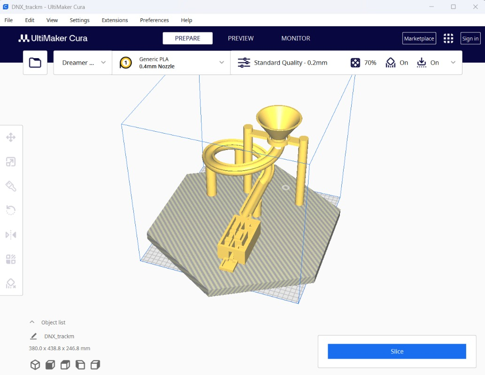
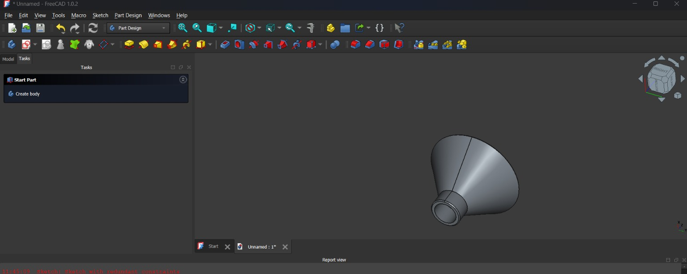
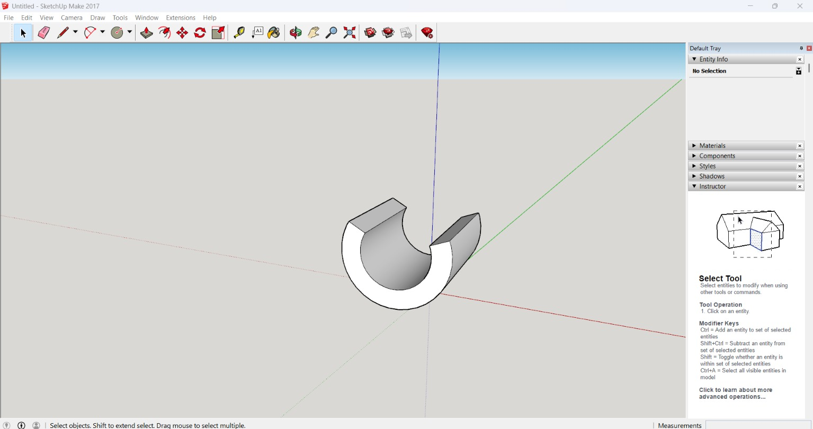
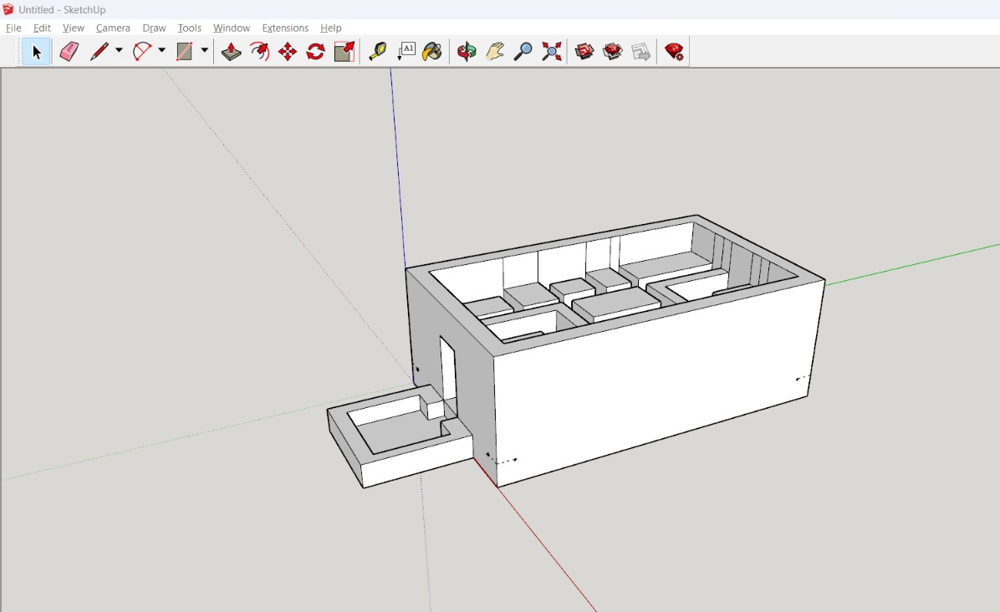
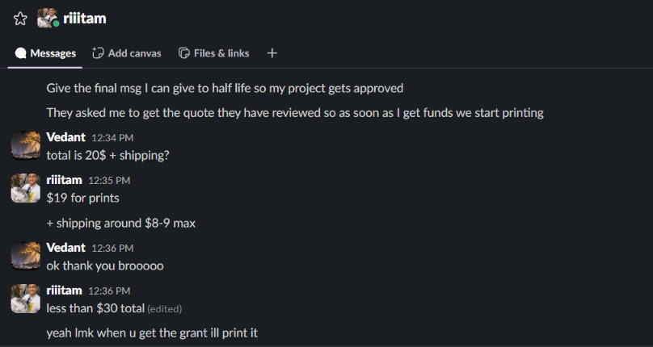

# Merbl

Merbl is a 3d printable marble run made in freecad.

## What is it?

Merbl is a marble run designed in CAD software it is basically divided into three parts:

- **Funnel:** It is the starting parts marble is thrown into it.
  
  

- **Round Track:** It is the second parts which is in two parts straight and a round track with this marble rolls down.
  
  

- **Maze:** This is the last part here marble passes through a small maze and reaches the end.
  
  

## Why?

It is my hack club's week 2 project.

## Project Status

It's stl, cad files everthing is included. It full usable 3d printable marble run.

## Printing

As merbl uses a round track it need some tree support print that parts. Other parts can be printed normally only funnel support is suggested to printed upside down.

## 3D Printing Quote

3D printing is quoted through Hack Club's Printing Legion via **riiitam** on Slack:

- **3D Printed Parts (Maze Parts):** $19.00
- **Estimated Shipping:** ~$8–$9 (budgeted at $10.00 max, under $30.00 total for printing + shipping)
- **Quote Message:** [Slack Quote](https://hackclub.slack.com/archives/D0CMGGYLXV2/p1795763156555599)

## Bill of Materials (BOM)

| Item | Qty | Supplier | Cost / Item | Total Cost | Link |
|---|:---:|---|:---:|:---:|---|
| **marble** | 1 | Amazon | $2.95 | $2.95 | [Amazon Bearing Balls](https://www.amazon.in/ART-IFACT-Pieces-Silver-Bearing/dp/B09LSBJ8W8/ref=sr_1_2?crid=15MSNP4B6XOLK&dib=eyJ2IjoiMSJ9.Q0oa2M6_XoMZ40JVDphCzGv9tzsf4Hoacan_oFG60Y3Sezah3AEsvziU_DImHJ5FY-gYz1ScnhxpmjnoHPdp4c2qw-cf7dNeRKNl104PW_aRFAE4axPt0NtL2aD8xhFpQRvDkR0SQmstc_vvhrTxrLTqhv0h0a3umMfJC33TuLgKZ3WhgML_4cyXNHbhBZayInEgSubhcGNVWwH9eSS2BNLp82XEQEA3aE5PMRyMpW6vTrbCkXHRHH2bTOoY1FSMcbIt0NMzbZjKdluEAPdMf-4gJPBUamq3A7OXaNnIJ1M.ILXsDEpkZpi_lqzzBeXfUBDmbdkrVw7nU9hzqPkwohA&dib_tag=se&keywords=8mm+marble&qid=1792680733&sprefix=8mm+marble%2Caps%2C314&sr=8-2) |
| **Maze Parts** | 1 | riiitam | $19.00 | $19.00 | [Printing Legion Quote](https://hackclub.slack.com/archives/D0CMGGYLXV2/p1795763156555599) |
| **Estimated total shipping** | 1 | | | $10.00 | |
| **Total** | | | | **$31.95** | |

## Repository content

- **`CAD/`**: Editable FreeCAD source files (`.FCStd`) and neutral STEP files (`.step`)
  - `straight.FCStd` – Straight track section
  - `track.FCStd` – Round track section
  - `funnel.FCStd` – Vortex funnel model
  - `marble_run_assembly.step` – Complete assembly in STEP format
  - `ee.skp`, `Untitled.skp`, `xyz.skp` – SketchUp CAD models
- **`stl/`**: 3D printable models (`.stl`, `.3mf`)
  - `funnel.stl` – Funnel
  - `fsupport.stl` – Funnel support (print upside down)
  - `track1.stl` & `trackf.stl` – Round track segments
  - `straight1.stl` – Straight track section
  - `maze1.stl` – Maze
  - `base1.stl` – Hexagonal base
  - `support.stl` & `supportshort.stl` – Track support pillars
  - `s50.stl` – 50mm riser column
  - `trackm.3mf` – 3MF build plate project file
- **`image/`**: Photos, screenshots, and CAD renders of the project
- **`BOM.csv`**: Bill of Materials with pricing and supplier details
- **`JOURNAL.md`**: Complete day-by-day design and development journal
