# 🌀 Marble Run Mini Hack – Highway to Half-Life (Week 2)

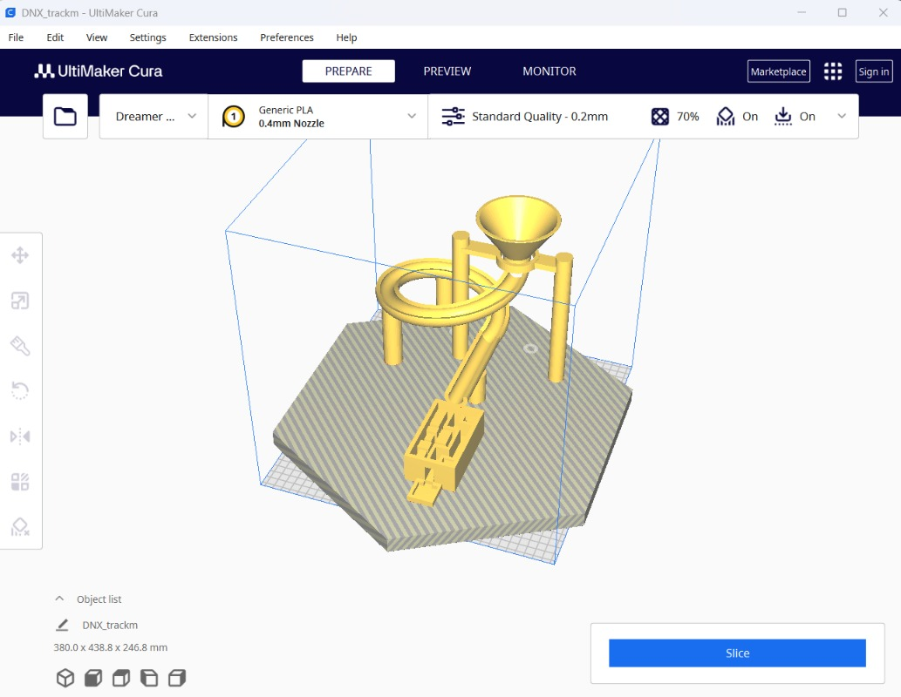

Welcome to the **Marble Run Mini Hack** repository, developed as part of **Hack Club's Highway to Half-Life (Week 2)**! 

This project is a custom-engineered, modular 3D-printed marble run featuring gravity-powered acceleration, a vortex funnel, an Archimedean spiral track, precision support pillars, a single-entrance obstacle maze, and an interlocking hexagonal foundation base.

---

## 📌 Project Overview

- **Challenge:** Hack Club Highway to Half-Life — Week 2 Mini Hack (Marble Run)
- **Author:** Pratham Prajapati ([@ez-pratham](https://github.com/ez-pratham))
- **CAD Tools:** FreeCAD, Onshape, SketchUp, OpenCASCADE
- **Slicing & 3D Printing:** Ultimaker Cura, PLA Filament
- **Total Development Time:** ~12 hours across 5 dedicated design and prototyping sessions

---

## ⚙️ How It Works

The marble run operates purely on gravitational potential energy converted into kinetic energy along custom mathematical trajectories:

```
  [Marble Infeed]
         │
         ▼
 ┌───────────────┐
 │ Vortex Funnel │  ◄── Swirling angular velocity & smooth centripetal drop
 └───────┬───────┘
         │
         ▼
 ┌───────────────┐
 │ Cylindrical   │  ◄── Elevates funnel to provide gravity head height (Z)
 │ Support Tower │
 └───────┬───────┘
         │
         ▼
 ┌───────────────┐
 │ Spiral Helical│  ◄── Banked U-channel preserves momentum without derailment
 │ Track Section │
 └───────┬───────┘
         │
         ▼
 ┌───────────────┐
 │ Single-Entry  │  ◄── Deceleration obstacle challenge testing path trajectory
 │ Obstacle Maze │
 └───────┬───────┘
         │
         ▼
 ┌───────────────┐
 │ Hexagonal Base│  ◄── Stable interlocking platform with marble catch basin
 └───────────────┘
```

1. **Vortex Inflow Funnel:** Marbles enter the upper cone where centrifugal force guides them in a decreasing spiral. As potential energy drops, angular velocity increases until the ball enters the vertical drop throat.
2. **Cylindrical Support Pillar:** Provides steady vertical elevation ($Z$-axis clearance) and acts as the structural spine, securely mating with the base.
3. **Continuous Spiral Helical Track:** The track cross-section is shaped as a banked U-channel with smooth inner radiuses. The bank angle counteracts lateral forces, allowing high-speed descent without the marble jumping off the rails.
4. **Precision Maze Obstacle:** Marbles enter through a single calibrated opening into an intricate maze designed to test friction, momentum, and exit trajectory before landing in the base.
5. **Rigid Hexagonal Base:** Designed to replace an initial four-square concept, the hexagonal geometry offers superior mechanical triangulation, interlocking slots for the uprights, and a clean runout area.

---

## 📸 Project Gallery

| Final Assembly | Hexagonal Base |
|:---:|:---:|
|  | 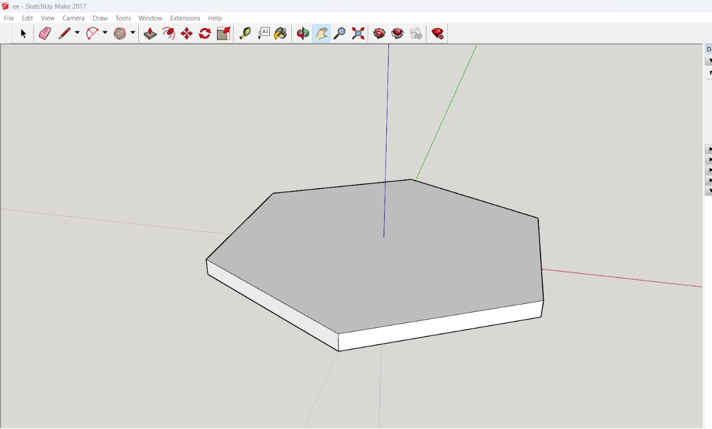 |

| Vortex Funnel & Tower | Helical Spiral Track |
|:---:|:---:|
| 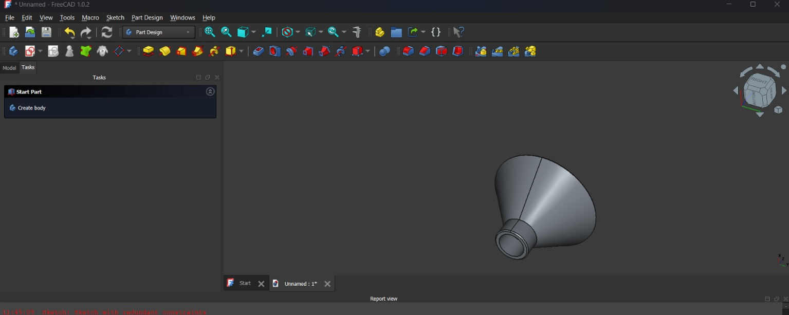 | 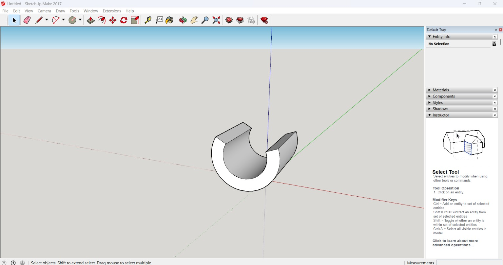 |

| Single-Entrance Maze | Slicing in Cura |
|:---:|:---:|
| 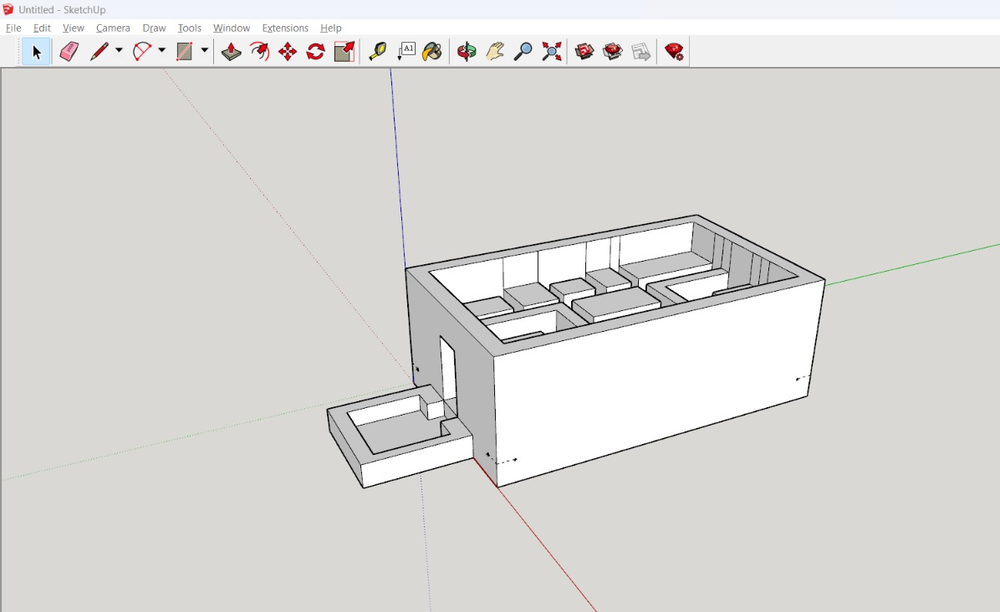 | 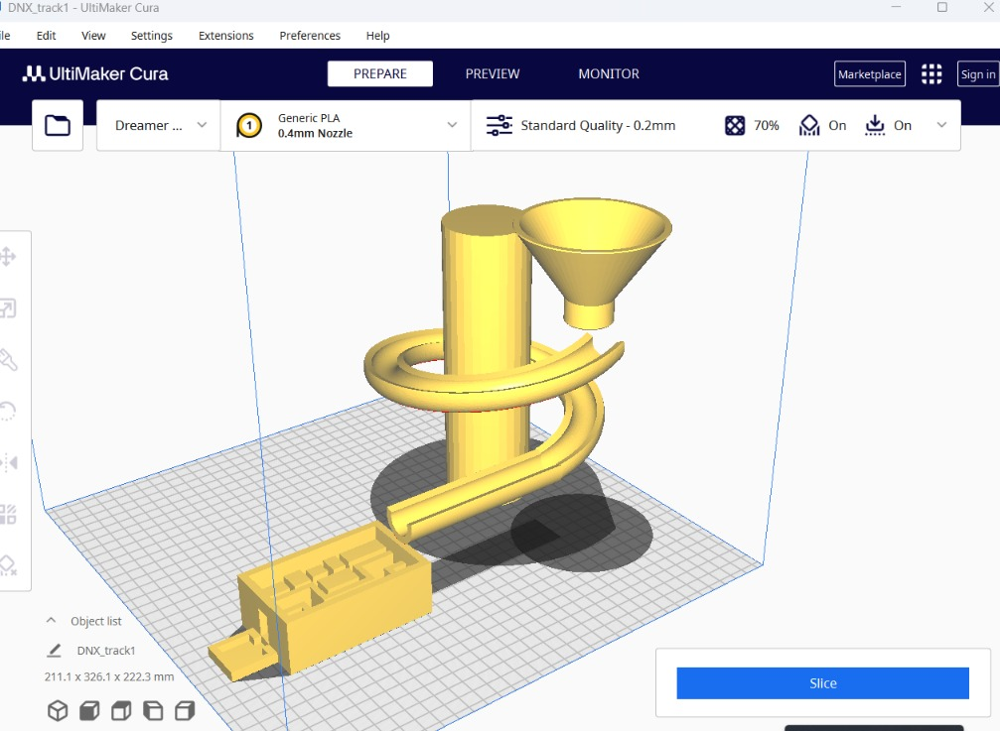 |

---

## 📖 Development Journal

### 🗓️ October 12: Planning and Starting the Design

Today was the first day of Week 2 of Hack Club's *Highway to Half-Life*, where the goal was to build a Marble Run Mini Hack.

I started by reading through the provided guide, but some of the technical CAD terminology was initially tricky to visualize. To get a practical grasp of **Onshape** (the browser-based CAD tool recommended in the guide), I dug into several YouTube modeling tutorials.

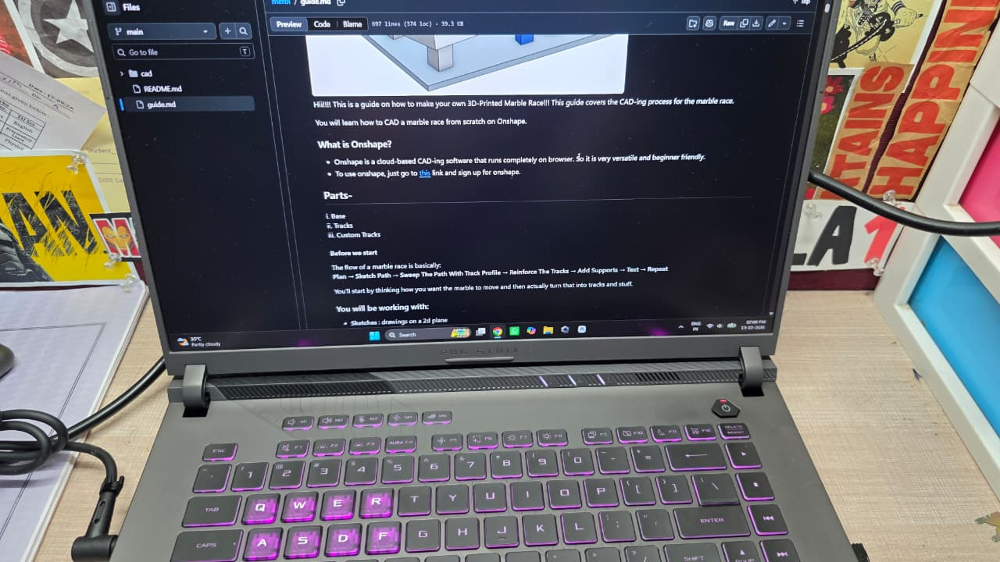

Prior to jumping straight into the software, I sketched several concept layouts on paper to map out how gravity would carry the ball between sections. I spent around two hours browsing ideas, looking at classic marble machines, and experimenting with concept images before settling on a cohesive design direction.

| Concept Sketch 1 | Concept Sketch 2 |
|:---:|:---:|
| 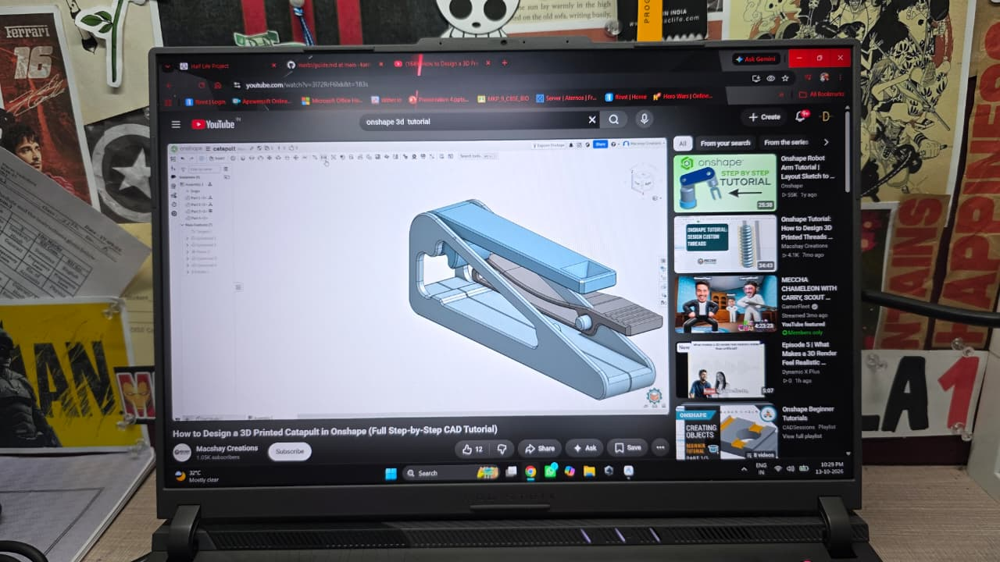 | 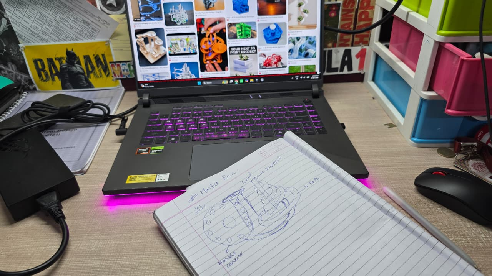 |

Once the layout was clear on paper, I hopped into Onshape and started modeling the foundation and basic track elements. Being new to Onshape made the parametric constraints a steep learning curve, but I got my initial shapes blocked out.

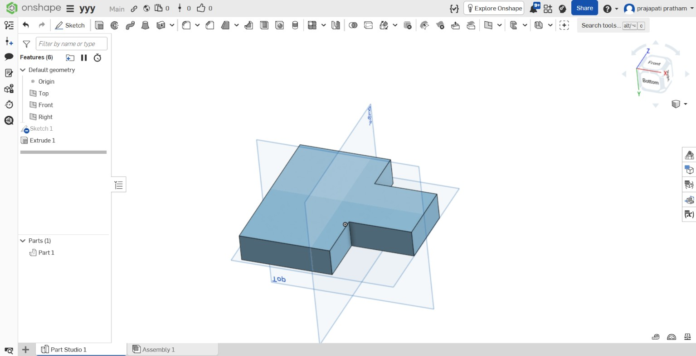

- **Session Time:** ~3 hours

---

### 🗓️ October 13: My First Attempt at 3D Modelling

Today I continued modeling in Onshape. I managed to produce a complete draft assembly that looked promising, but certain curve transitions and lofts weren't behaving cleanly or fitting together as tightly as I wanted.

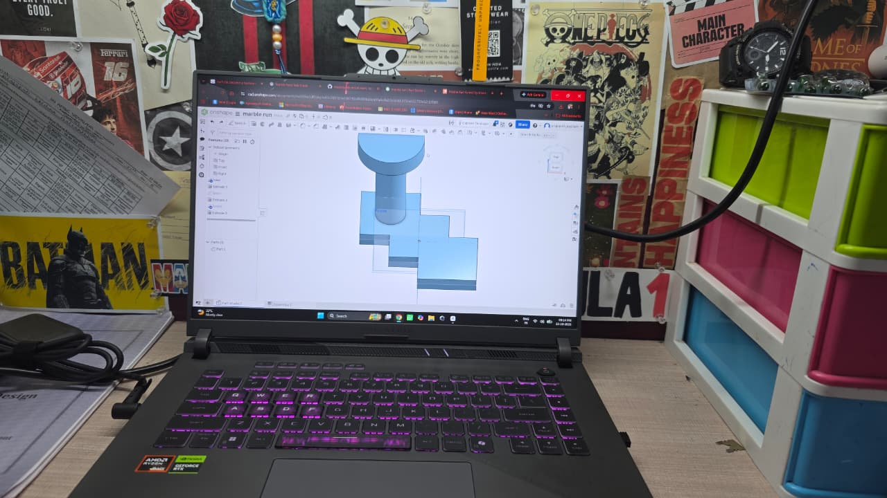

After wrestling with the web-based constraints for about two hours, I made the executive decision to switch over to **FreeCAD**, as I was already somewhat familiar with its local workbench workflow (Part Design and Sketcher). This switch gave me much finer parametric control over complex sweeps and helical geometries.

- **Session Time:** ~2 hours

---

### 🗓️ October 14–15: Working on the Modular Components

#### October 14: Funnel and Helical Track
On the 14th, I started modeling the core functional components.
1. **Funnel & Cylindrical Tower:** I designed the tall cylindrical support first to establish the overall vertical drop height. Then, after studying vortex funnel dynamics, I revolved a sketch profile to create a smooth conical funnel with a chamfered exit port.

| Funnel Support Column | Funnel CAD Model |
|:---:|:---:|
| 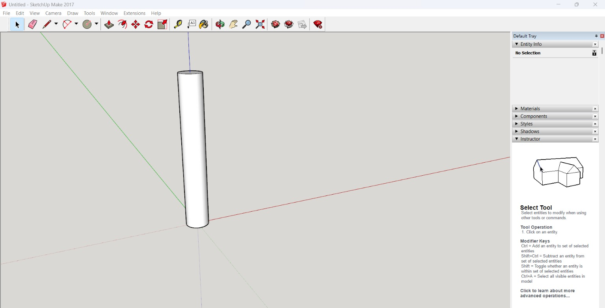 |  |

2. **Spiral Track:** The most critical challenge was the helical track. The marble had to fit snugly inside the track channel without jamming or jumping out. I calculated the necessary clearance, modeled a custom profile, and generated a continuous helical sweep. I tested multiple pitch and diameter variations before reaching a track geometry that guaranteed smooth rolling.

| Spiral Track Geometry | Track Radius & Pitch Tuning |
|:---:|:---:|
|  | 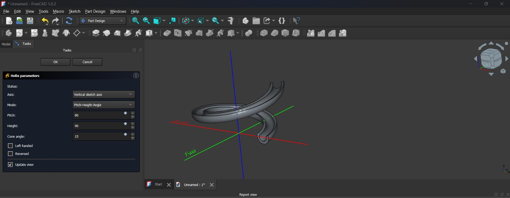 |

#### October 15: The Single-Entrance Maze
On the 15th, I designed the final challenge module: the maze. With the track and funnel complete, the maze was the area where I had full creative freedom.

I designed an intricate labyrinth featuring a single calibrated entrance. The marble enters from the track, navigates the internal walls, and exits into the collection zone. After finishing the CAD geometry, I prepared and sliced the model in Ultimaker Cura to verify print orientation, wall thicknesses, and overhang angles.

| Maze 3D Model | Slicing in Cura |
|:---:|:---:|
|  |  |

Across October 14 and 15, we spent about six hours iterating on tolerances and mating connectors.
- **Combined Session Time (Oct 14–15):** ~6 hours

---

### 🗓️ October 16: Completing the Design & Base Redesign!

Today, I realized that the entire assembly was missing its foundational anchor: the base!

I initially experimented with a base composed of four squares arranged diagonally—two large squares and two small ones meeting at a shared central intersection. However, when placing the support towers onto it, the aesthetic felt unbalanced and the footprint didn't provide enough mechanical stability against vibrations.

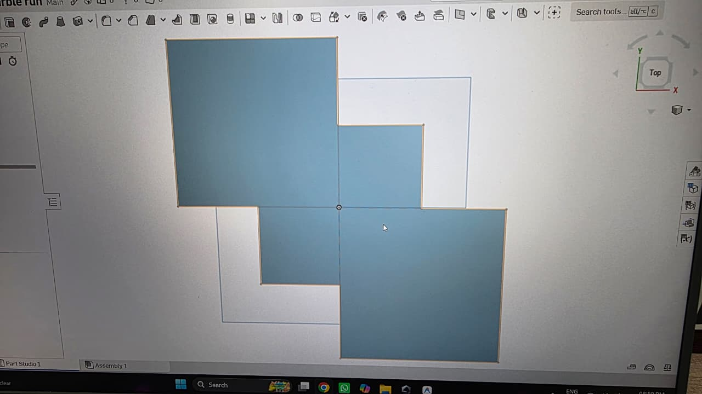

I went back to the drawing board and completely redesigned the base using a symmetrical **hexagonal geometry**. The hexagon gave uniform structural support across all radial axes, accommodated the tower and track uprights neatly, and looked significantly sleeker.


With the hexagonal base complete, all components came together into the final completed marble run!


- **Session Time:** ~1 hour
- **Total Project Time:** **~12 hours**

---

## 📁 Repository Structure

```
marble-run-/
├── README.md               # Complete project documentation and design log
├── .gitignore              # Git ignore rules for build artifacts and temp files
│
├── CAD/                    # 🛠️ Editable CAD Source Files (.step, .fcstd, .skp)
│   ├── straight.FCStd      # Straight track section (FreeCAD)
│   ├── track.FCStd         # Helical spiral track (FreeCAD)
│   ├── funnel.FCStd        # Vortex funnel model (FreeCAD)
│   ├── Unnamed.FCStd       # Original FreeCAD workspace file
│   ├── marble_run_assembly.step # Complete machine assembly (STEP standard)
│   ├── ee.skp              # Concept component (SketchUp)
│   ├── Untitled.skp        # Preliminary assembly (SketchUp)
│   └── xyz.skp             # Geometric testing model (SketchUp)
│
├── stl/                    # 🖨️ 3D Printable Models (.stl, .3mf)
│   ├── base1.stl           # Hexagonal foundation base
│   ├── funnel.stl          # Vortex infeed funnel
│   ├── fsupport.stl        # Funnel upright support pillar
│   ├── track1.stl          # Helical track segment
│   ├── trackf.stl          # Spiral track transition piece
│   ├── straight1.stl       # Straight track segment
│   ├── maze1.stl           # Single-entrance labyrinth maze
│   ├── support.stl         # Standard vertical support pillar
│   ├── supportshort.stl    # Short support riser
│   ├── s50.stl             # 50 mm riser column
│   └── trackm.3mf          # Ultimaker Cura build plate project file
│
├── image/                  # 📷 Photographs, screenshots, and CAD renders
│   ├── final_assembly.jpeg # Final completed project photo
│   ├── hexagonal_base.jpeg # Hexagonal base render
│   ├── diagonal_base_concept.jpeg # Four-square diagonal base test
│   ├── maze_design.jpeg    # CAD model of maze
│   ├── maze_slicing.jpeg   # Sliced preview of maze in Cura
│   ├── spiral_track_1.jpeg # CAD spiral track view 1
│   ├── spiral_track_2.jpeg # CAD spiral track view 2
│   ├── funnel_design.jpeg  # CAD funnel model
│   ├── funnel_cylindrical_support.jpeg # Funnel support column
│   ├── freecad_first_attempt.jpeg # First modeling session
│   ├── onshape_first_attempt.jpg  # Onshape prototype
│   ├── paper_sketch_1.jpeg # Initial concept sketch
│   ├── paper_sketch_2.jpeg # Track layout sketch
│   └── onshape_learning.jpeg      # CAD tutorial study
│
├── drawings/               # 📐 Technical Drawings & Dimensioned Blueprints
│   ├── technical_drawing_dimensioned.png
│   └── exploded_view_assembly.png
│
├── renders/                # 🎨 High-resolution 3D Renders
│   ├── assembly_isometric.png
│   ├── assembly_top_view.png
│   ├── assembly_side_view.png
│   ├── helix_detail.png
│   ├── infinity_crossover.png
│   └── tower_cutaway.png
│
└── docs/                   # 📄 Engineering & Assembly Documentation
    ├── ASSEMBLY_INSTRUCTIONS.md
    ├── BILL_OF_MATERIALS.md
    └── ENGINEERING_REPORT.md
```

---

## 🖨️ 3D Printing Recommendations

| Parameter | Recommended Setting | Rationale |
|---|---|---|
| **Material** | PLA or PETG | Rigid dimensional stability, minimal warping |
| **Layer Height** | 0.20 mm (0.16 mm for funnel) | Balances print speed with smooth curved channel walls |
| **Infill** | 15% – 20% Gyroid or Grid | Provides internal stiffness for tall pillars |
| **Perimeters / Walls** | 3 walls (1.2 mm total thickness) | Ensures tracks withstand marble impact |
| **Supports** | Tree supports where needed | Essential for funnel overhangs and spiral track undersides |
| **Bed Adhesion** | Brim recommended for tall pillars | Prevents tall supports from detaching during printing |

---

## 🧩 Assembly & Testing Instructions

1. **Base Setup:** Place the `base1.stl` on a flat, level surface.
2. **Support Installation:** Insert `fsupport.stl`, `support.stl`, and `supportshort.stl` into their keyed mounting sockets on the hexagonal base.
3. **Funnel Mounting:** Align and press-fit the `funnel.stl` onto the primary cylindrical support tower.
4. **Track Alignment:** Connect `track1.stl` and `straight1.stl` to guide marbles directly from the funnel throat into the spiral descent.
5. **Maze Positioning:** Secure `maze1.stl` at the foot of the spiral track so the marble enters directly through the single inlet slot.
6. **Testing & Tuning:** Drop standard 14–16 mm marbles into the funnel and observe the run! Adjust pillar seating to maintain consistent downward slope angles.

---

## 📜 License & Credits

Created by **Pratham Prajapati** for **Hack Club's Highway to Half-Life** (Week 2 Marble Run Mini Hack).  
CAD designs licensed under [MIT License](LICENSE).
